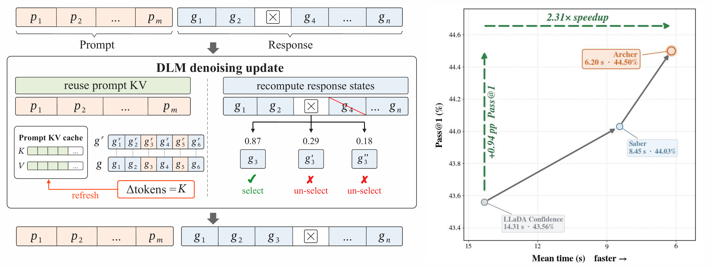

# Archer

### Adaptive Reuse of Cached Hidden States for Efficient Rollback in Diffusion Language Models

<p align="center">
  <a href="https://arxiv.org/abs/2608.08086"><strong>Paper</strong></a>
  &nbsp;|&nbsp;
  <a href="https://arxiv.org/pdf/2608.08086"><strong>PDF</strong></a>
</p>

<p align="center">
  
</p>

Archer is a training-free prompt KV-caching method for rollback-capable
diffusion language models (DLMs). It reuses the fixed prompt states, recomputes
the response states that remain subject to revision, and refreshes the prompt
cache when the response moves sufficiently far from its cached anchor. This
repository provides the minimal path needed to reproduce the **Archer rows in
Table 1**.

## Quick start

### 1. Requirements

- Linux and `git`;
- Python 3.10 or 3.11;
- [`uv`](https://docs.astral.sh/uv/);
- one NVIDIA GPU with at least 40 GB of memory.

### 2. Install the environment

```bash
git clone https://github.com/Hxnng/Archer.git
cd Archer
./setup.sh
```

`setup.sh` creates the locked Python environment, downloads the pinned
LLaDA-8B-Instruct checkpoint, verifies the bundled MBPP and HumanEval
snapshots, and prepares the pinned LiveCodeBench evaluator and dataset.

If Hugging Face is unavailable from your network, set a compatible endpoint
before setup, for example:

```bash
HF_ENDPOINT=https://hf-mirror.com ./setup.sh
```

An existing model checkout can be reused:

```bash
ARCHER_LLADA_MODEL_PATH=/path/to/LLaDA-8B-Instruct ./setup.sh
```

### 3. Reproduce the Archer rows

Run all three Table 1 benchmarks with their paper-default refresh radii:

```bash
CUDA_VISIBLE_DEVICES=0 ./reproduce.sh
```

Run a single benchmark:

```bash
CUDA_VISIBLE_DEVICES=0 ./reproduce.sh mbpp
CUDA_VISIBLE_DEVICES=0 ./reproduce.sh livecodebench
CUDA_VISIBLE_DEVICES=0 ./reproduce.sh humaneval
```

The default values are read from
[`configs/table1_archer.json`](configs/table1_archer.json): MBPP uses $K=11$,
LiveCodeBench uses $K=10$, and HumanEval uses $K=8$.

## Choose another refresh radius

Pass `--k` to override the paper default without editing a configuration file:

```bash
CUDA_VISIBLE_DEVICES=0 ./reproduce.sh mbpp --k 16
```

Custom-radius outputs use a distinct run name such as
`table1_archer_mbpp_k16`, so they cannot overwrite the default Table 1 run.
The same override can be applied to all three benchmarks:

```bash
CUDA_VISIBLE_DEVICES=0 ./reproduce.sh all --k 16
```

## Verify before a full run

Print the exact commands without downloading or loading a model:

```bash
./reproduce.sh --dry-run
./reproduce.sh humaneval --k 16 --dry-run
```

After setup, run two examples as an end-to-end smoke test:

```bash
CUDA_VISIBLE_DEVICES=0 ./reproduce.sh mbpp --limit 2
```

Interrupted runs resume by default. Add `--no-resume` to request a fresh run.

Every run records its arguments, model revision, GPU, per-problem generations,
timing, and aggregate evaluation. Outputs are written below:

```text
outputs/table1/table1_archer/
├── table1_archer_mbpp/
├── table1_archer_livecodebench/
└── table1_archer_humaneval/
```

Each run directory contains the raw JSONL generations, evaluation details,
manifest, and `summary.json`.

## Repository layout

```text
configs/table1_archer.json       # Table 1 Archer defaults
reproduce.sh                     # user-facing reproduction entry point
scripts/run_experiment.py        # versioned config runner
src/archer/state_distance/       # Archer cache controller and sampler
src/archer/benchmark.py          # Archer generation and evaluation pipeline
benchmarks/                      # versioned benchmark snapshots and checksums
```

Evaluation executes model-generated Python programs. Run the artifact in an
isolated environment without credentials or access to sensitive files.

## Citation

If Archer is useful for your research, please cite our paper:

```bibtex
@misc{he2026archer,
  title         = {Archer: Adaptive Reuse of Cached Hidden States for Efficient Rollback in Diffusion Language Models},
  author        = {Xuning He and Zinan Sheng and Yongding Tao and Huanyu Liu and Ge Li and Xue Jiang and Yihong Dong},
  year          = {2026},
  eprint        = {2608.08086},
  archivePrefix = {arXiv},
  primaryClass  = {cs.CL},
  url           = {https://arxiv.org/abs/2608.08086}
}
```
