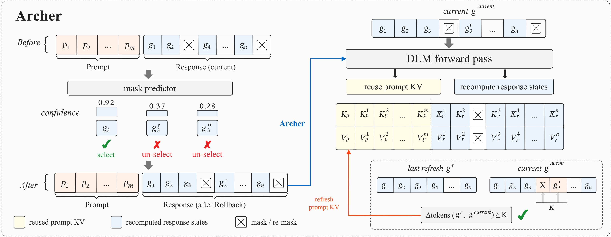

<div align="center">


**Adaptive Reuse of Cached Hidden States for Efficient Rollback in Diffusion Language Models**

<p>
  <a href="https://arxiv.org/abs/2608.08086"></a>
  <a href="#results"></a>
  <a href="#quick-start"></a>
  <a href="docs/REPRODUCIBILITY.md"></a>
</p>

</div>

**Archer makes rollback-capable diffusion language models faster while keeping every generated token revisable.** It is a training-free KV caching method that reuses prompt states, recomputes the evolving response, and synchronizes the cache according to response-state drift. The model weights and rollback rules stay unchanged. Across eight code and reasoning benchmarks, Archer reaches up to **4.33× speedup** over LLaDA-Confidence.

Diffusion language models can reconsider earlier predictions when later context reveals a mistake. This ability comes at a cost: each revision can require another forward pass over the entire prompt and response. Under bidirectional attention, even an unchanged prompt acquires new representations as the response evolves. Archer addresses the resulting cache-invalidation problem by separating **the fixed prompt tokens** from **the response states that remain open to correction**.

<p align="center">
  
  <br>
  <sub>Reuse prompt K/V, recompute the response, and refresh when response-state distance reaches K.</sub>
</p>

Archer brings four ideas together:

- **A cache boundary aligned with rollback.** Persist only prompt K/V and recompute every response position before the next decoding decision. Accepted tokens can still be replaced or re-masked as new context arrives.
- **Refresh driven by state changes.** Compare the current response with the snapshot that produced the prompt cache. Small changes allow continued reuse; sufficient drift triggers a full refresh, making synchronization depend on the evolving hypothesis.
- **Controlled prompt feedback.** Temporarily anchoring prompt states delays the feedback of tentative tokens through the prompt. The paper studies how this can reduce premature reinforcement of transient errors, alongside the approximation introduced by stale prompt states.
- **Training-free, inspectable inference.** The controller works with the existing checkpoint and sampler. Versioned experiments record generations, timing, model calls, and cache diagnostics so that the effect of reuse can be examined directly.

Prompt reuse is approximate and can change the decoding trajectory. The paper characterizes its state-dependent error and gives conditions for preserving full-refresh decisions; the implementation keeps response revision available throughout. See the [method and analysis](https://arxiv.org/html/2608.08086v2#S4) and [cache controller](src/archer/state_distance/sampler.py).

## Results

**One backbone, eight benchmarks, a common speed baseline.** The overview compares LLaDA-Confidence, rollback-capable Saber, and Archer with **LLaDA-8B-Instruct** across code generation, mathematics, finance, biomedicine, science, and subject-specific reasoning. These are the three methods evaluated across the full suite; the detailed main comparison also includes Fast-dLLM, dKV-Cache, and dLLM-Cache.

<p align="center">
  
  
</p>

The results show three aspects of the method:

- **A stronger measured quality–speed balance on code.** Archer reaches **33.63% mean Pass@1**, the highest among the main comparison's methods, with **2.57× mean speedup** over LLaDA-Confidence. Relative to Saber, it reduces latency on all three code benchmarks and improves both extended-test scores. The quality mean averages five scores, including MBPP-ET and HumanEval-ET.
- **Transfer beyond program synthesis.** Across five reasoning benchmarks, Archer reaches **48.37% macro-average accuracy**, compared with 47.32% for LLaDA-Confidence, while providing **2.47× mean speedup**. On FinQA, numerical-answer accuracy rises from 28.51% to 30.17% while latency falls from 42.65 to 9.86 seconds, a **4.33× speedup**.
- **Revision remains active.** The separate Table 4 study finds that Archer revises **26.93–30.24%** of response positions, with a similar number of response updates to Saber. The measured acceleration is consistent with reducing repeated prompt computation while retaining the correction process.

All speedups in the figure use **LLaDA-Confidence** as the denominator. Code rows report Pass@1; reasoning rows report accuracy. ET adds tests to the same code tasks. MMLU-Pro pools Engineering and Physics (2,268 questions); FinQA measures numerical-answer accuracy. Quality changes vary by task, and the full tables retain both gains and decreases.

See the [complete comparisons and metric definitions](docs/RESULTS.md), [main reference values](results/table1_reference.json), [reasoning results](results/noncode_reference.json), and [rollback statistics](results/rollback_reference.json). The public runner reproduces Archer's three Table 1 code-generation runs; the broader studies are supplied as reference data.

## Quick start

Use **Linux**, **Python 3.10 or 3.11**, [`uv`](https://docs.astral.sh/uv/), `git`, and **one NVIDIA GPU with at least 40 GB of memory**.

### Inspect the experiments

```bash
git clone https://github.com/Hxnng/Archer.git
cd Archer

# Inspect the experiment commands without downloading a model.
./reproduce.sh --dry-run
```

The dry run prints the exact commands for all three code benchmarks. It works before environment setup and needs no GPU or model weights.

### Set up and reproduce

```bash
# Install the locked environment, model, datasets, and evaluators.
./setup.sh

# Reproduce the three Archer rows in Table 1.
CUDA_VISIBLE_DEVICES=0 ./reproduce.sh
```

Setup creates the locked Python environment, downloads the pinned LLaDA-8B-Instruct checkpoint, verifies the bundled MBPP and HumanEval snapshots, and prepares the pinned official LiveCodeBench evaluator with its 400-task dataset. This keeps model, input, and evaluation versions explicit for each experiment.

### Select a benchmark or refresh radius

```bash
CUDA_VISIBLE_DEVICES=0 ./reproduce.sh mbpp
CUDA_VISIBLE_DEVICES=0 ./reproduce.sh livecodebench
CUDA_VISIBLE_DEVICES=0 ./reproduce.sh humaneval
CUDA_VISIBLE_DEVICES=0 ./reproduce.sh mbpp --k 16
```

The `--k` option changes the cache refresh radius. Overrides receive separate run names, so a new radius can be compared with the configured run. Experiment settings live in [`configs/table1_archer.json`](configs/table1_archer.json).

### Inspect and continue a run

Matching interrupted runs resume automatically. Each run saves its outputs under `outputs/table1/table1_archer/`, including a `manifest.json` with the requested configuration, model revision, and GPU, and a `summary.json` with aggregate evaluation results. Per-problem generations, timing, and cache diagnostics support more detailed analysis.

For an existing model checkout, download mirrors, an isolated two-example smoke test, and fresh output directories, follow the [reproduction guide](docs/REPRODUCIBILITY.md). Evaluation executes generated Python, so use an isolated environment without credentials or sensitive files.

### Explore the implementation

- [`src/archer/state_distance/`](src/archer/state_distance/) implements prompt-cache construction, response-distance checks, and adaptive refresh.
- [`src/archer/saber.py`](src/archer/saber.py) contains the rollback transition used by Archer.
- [`src/archer/benchmark.py`](src/archer/benchmark.py) connects generation, evaluation, diagnostics, and run manifests.
- [`benchmarks/`](benchmarks/) documents input snapshots; the [vendored dependency notes](src/archer/_vendor/README.md) identify the model and evaluator sources.

## Citation

```bibtex
@misc{he2026archer,
  title         = {Archer: Adaptive Reuse of Cached Hidden States for Efficient Rollback in Diffusion Language Models},
  year          = {2026},
  eprint        = {2608.08086},
  archivePrefix = {arXiv},
  primaryClass  = {cs.CL},
  url           = {https://arxiv.org/abs/2608.08086}
}
```
